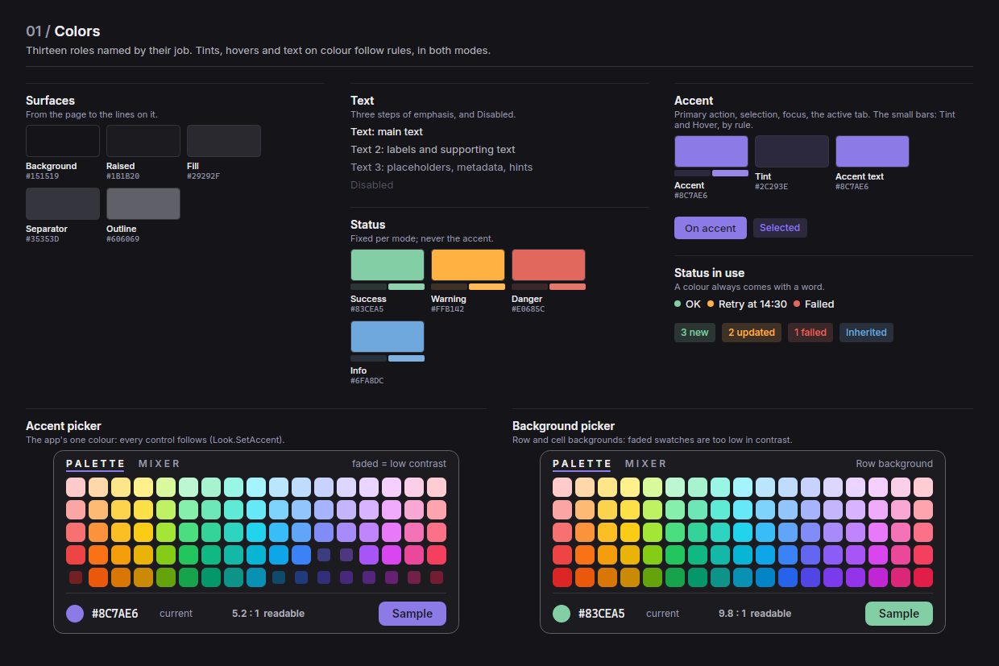
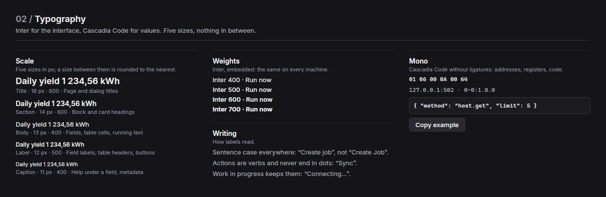
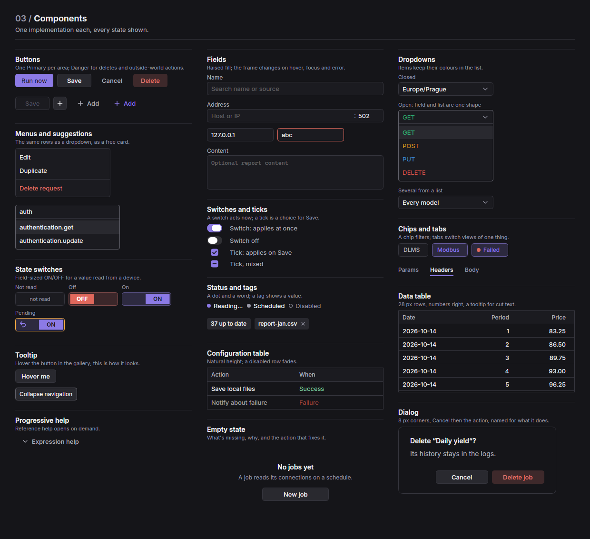
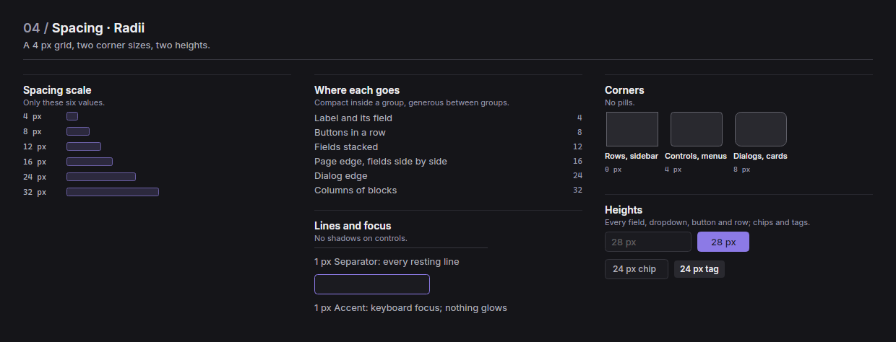
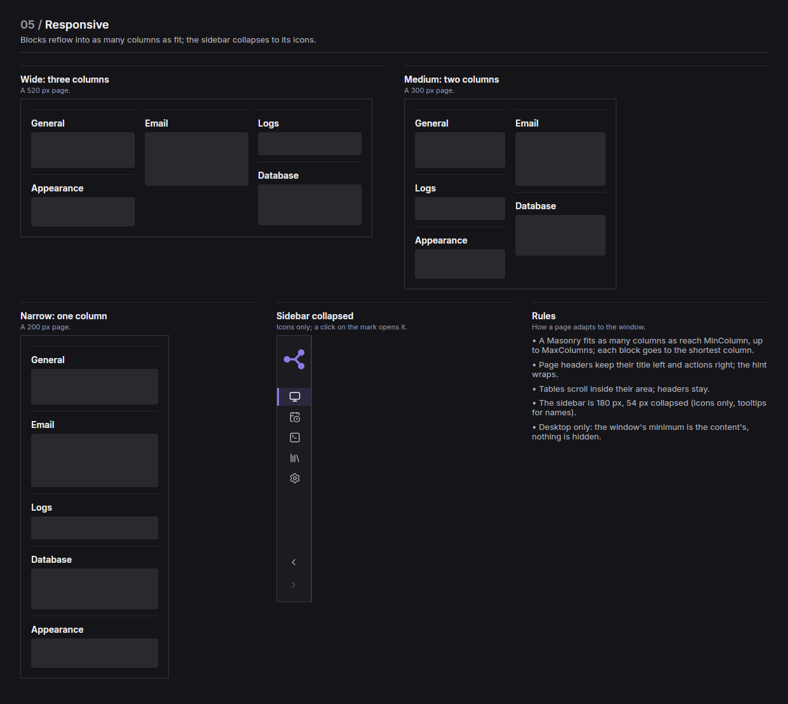
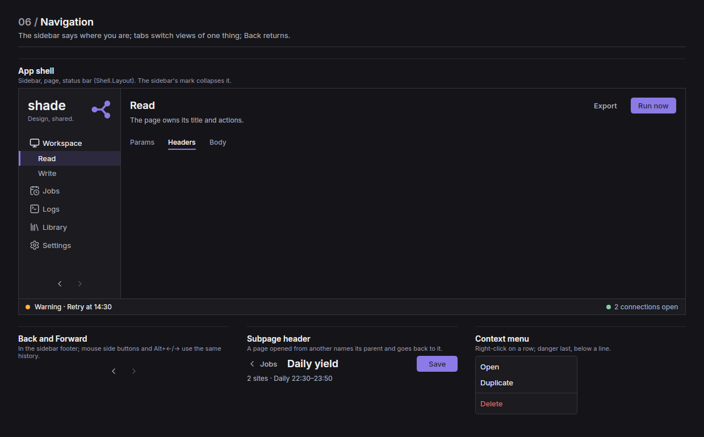

# Shade

A dark-first design system for desktop work tools, with a matching light mode. People keep these apps open for hours to
configure, watch and act on data. Shade is a C# library for Avalonia 12 (.NET 10): the tokens above are read from its
code, and every preview below is rendered from its components.

| | |
| --- | --- |
| **Install** | `<PackageReference Include="Shade" Version="1.0.0" />` or a project reference to `src/Shade` |
| **Start** | `Look.SetMode(Mode.Dark)`, then `Look.Apply(app)` and build the windows |
| **Rules** | [docs/DESIGN_SYSTEM.md](docs/DESIGN_SYSTEM.md) |
| **Gallery** | `dotnet run --project gallery -c Release` (the mode button switches dark and light) |

## Overview

- **Calm and dense.** Neutral greys carry the layout. One colour, the **accent**, marks the main action, the selection and
  focus. Status colours appear only beside the word they stand for.
- **Colours are roles, not shades.** Thirteen named roles (`{colors.background}` to `{colors.info}`). Tints, hovers and text
  on a coloured fill are worked out by rule, so a new accent or a new mode needs no new values.
- **One size for everything you click:** 28 px fields, buttons, dropdowns and table rows; 24 px chips and tags.
- **Boxes are rare.** A page is a masonry of blocks, each with a heading and a faint line above it. Cards and boxes are
  kept for dialogs, menus and reference help.
- **Two modes, one set of rules.** Dark is the default; light uses the same roles with its own values.

## 01 / Colors

| Dark | Light |
| --- | --- |
|  |  |

**Surfaces.** `{colors.background}` is the page; `{colors.raised}` holds fields, menus, the sidebar and table headers;
`{colors.fill}` is hover and the Secondary button; `{colors.separator}` is every resting 1 px line; `{colors.outline}` is a
control's border on hover or while open.

**Text.** `{colors.text}` for main text, `{colors.text-2}` for labels, `{colors.text-3}` for placeholders and hints. All
three read at 4.5:1 or better on `{colors.raised}` in both modes (checked whenever the docs are made).

**Accent.** The app's one colour, chosen by the user (default `#8C7AE6`). Made from it by rule:

- **Tint:** 15 % over Raised (`{colors.accent-tint}`), for selected rows and active chips.
- **Hover:** 10 % lighter (`{colors.accent-hover}`).
- **Accent text:** moved toward the high-contrast end until it reads at 4.5:1 (`{colors.accent-text}`).
- **On accent:** dark ink or white, whichever reads better (`{colors.on-accent}`).

**Status.** `{colors.success}`, `{colors.warning}`, `{colors.danger}`, `{colors.info}`. They're fixed for each mode and never
the accent; the accent picker warns when a chosen accent is too close to one. A status colour always comes with its word.

## 02 / Typography

| Dark | Light |
| --- | --- |
|  |  |

- **Inter**, embedded in the package, so it looks the same on every machine. Five sizes: Title 18, Section 14, Body 13,
  Label 12, Caption 11. A size between them is rounded to the nearest step.
- **Cascadia Code** without ligatures for addresses, registers, code and anything that is a value.
- Sentence case everywhere. An action is a verb and never ends in dots ("Sync"); work in progress keeps them
  ("Connecting…").

## 03 / Components

| Dark | Light |
| --- | --- |
|  |  |

| Component | Code | Rule |
| --- | --- | --- |
| Buttons | `Btn` (Primary, Normal, Ghost, Del), `Capsule`, `IconButton` | One Primary per area; Danger for deletes and outside-world actions |
| Fields | `Field`, `HostPortField`, `Workbench.Lines` | Raised fill; only the frame changes (Outline, Accent, Danger) |
| Dropdowns | `ChoiceButton`, `MultiChoice` | Open, field and list are one shape; items keep their colours |
| Menus and suggestions | `Menu.Panel`, `Menu.Show`, `SuggestionField` | Same rows as the dropdown; danger last, below a line |
| Switches and ticks | `Switch`, `Tick`, `TickGrid` | A switch acts now; a tick is a choice for Save |
| Chips and tabs | `FilterChip`, `TextTabs` | A chip filters; tabs switch views of one thing, never pages |
| State switches | `StateToggle`, `StateLook` | ON/OFF the size of a field, with Unknown and Pending |
| Status and tags | `StatusBadge`, `Tag` | A dot and a word; a tag shows a value |
| Tables | `Workbench.Table`, `CompactTable`, `PairTable` | 28 px rows, numbers right, cut text in a tooltip |
| Tooltip | `ToolTip.SetTip` (styled by `Look.Apply`) | Fill, Outline, Label text |
| Dialogs | `Ask.Confirm`, `Ask.ConfirmDelete`, `Ask.Info`, `Dialog` | Cancel, then the action named for what it does |
| Colour pickers | `ColorGrid` | Faded swatches are too low in contrast for the job |
| Help and empty states | `FormLayout.Disclosure`, `InlineCode`, `Kit.Empty` | Help opens on demand; an empty list says what fixes it |

## 04 / Spacing · Radii

| Dark | Light |
| --- | --- |
|  |  |

- **Spacing** is a 4 px grid using only 4, 8, 12, 16, 24 and 32 (`Look.Spaces`): tight inside a group, generous between
  groups.
- **Corners:** `{rounded.control}` on controls and menus, `{rounded.card}` on dialogs and cards, none on rows and the
  sidebar. No pills.
- **Heights:** `{sizes.control-height}` and `{sizes.chip-height}`.
- **Lines and focus:** 1 px `{colors.separator}`; keyboard focus is a 1 px `{colors.accent}` border. No shadows or glows on
  controls.

## 05 / Responsive

| Dark | Light |
| --- | --- |
|  |  |

- A page is a `Masonry`: as many columns as reach `MinColumn` (up to `MaxColumns`), each block placed in the shortest
  column. One layout, from a narrow window to a wide one.
- Page headers keep their title left and their actions right; the hint wraps.
- Tables scroll inside their area, under a header that stays.
- The sidebar is 180 px, or 54 px collapsed (icons with tooltips).
- Desktop only: the window's minimum size is its content's, and nothing is hidden at small sizes.

## 06 / Navigation

| Dark | Light |
| --- | --- |
|  |  |

- **App shell** (`Shell.Layout`): the `Sidebar` left, the page right, the `StatusBar` under both.
- **Sidebar** (`Sidebar`, `NavEntry`): the app's name and mark at the top, then top-level entries with Lucide icons. An entry
  with children opens them while one is current. The active row has `{colors.accent-tint}` and a 3 px accent marker. A
  click on the mark collapses the bar with a 420 ms roll.
- **Back and Forward** (`NavigationButtons`) sit in the sidebar footer. Mouse side buttons and Alt+←/→ use the same history.
- **Page headers** (`FormLayout.Header`, `FormLayout.SubHeader`): every page owns its title and actions; a subpage names
  its parent and returns to it. There is no breadcrumb bar and no global toolbar.
- **Status bar** (`StatusBar`): the latest problem on the left, a live count on the right.

## Do's and Don'ts

**Do**

- Build every screen from Shade's components and tokens.
- Keep one Primary button per area.
- Put a word next to every status colour.
- Set the mode before building windows; switch by building them again.

**Don't**

- Write a colour, size or corner as a literal in a view.
- Use the accent for status, or a status colour for decoration.
- Add a box around a block of a page; the line above it is enough.
- End an action label in dots.

## Keeping this file true

The token block at the top and every image above come from the code:
`dotnet run --project gallery -c Release -- --docs .` renders the twelve previews and rewrites the tokens (it first runs the
contrast and component checks). CI runs it on every push and fails when `DESIGN.md` differs from what's committed.
