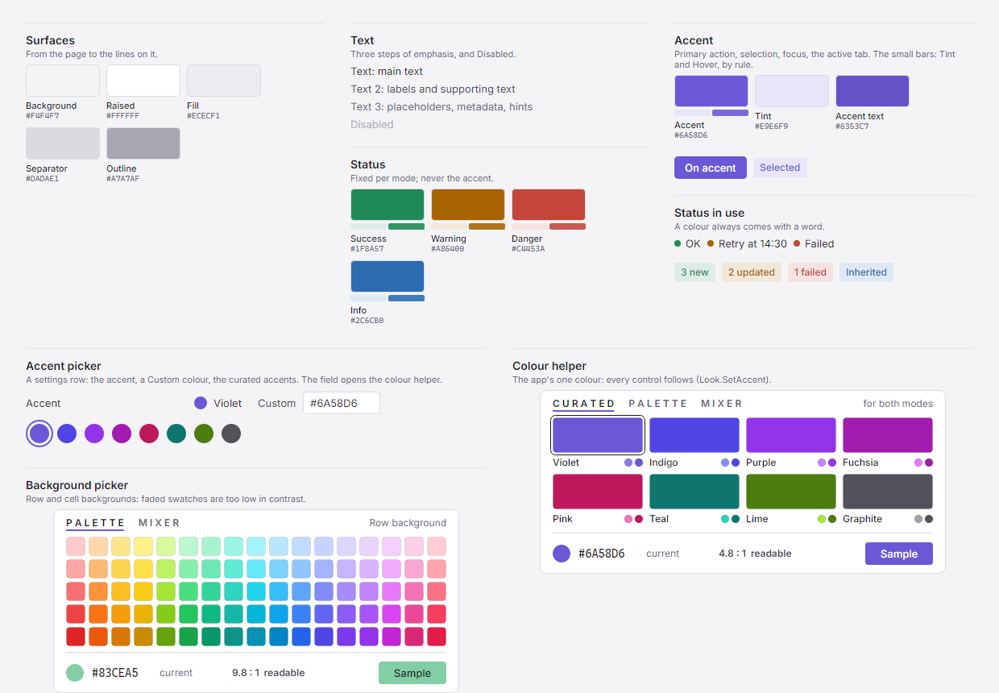
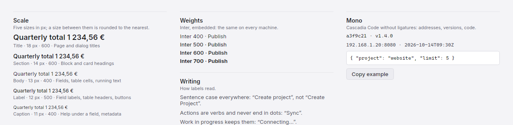
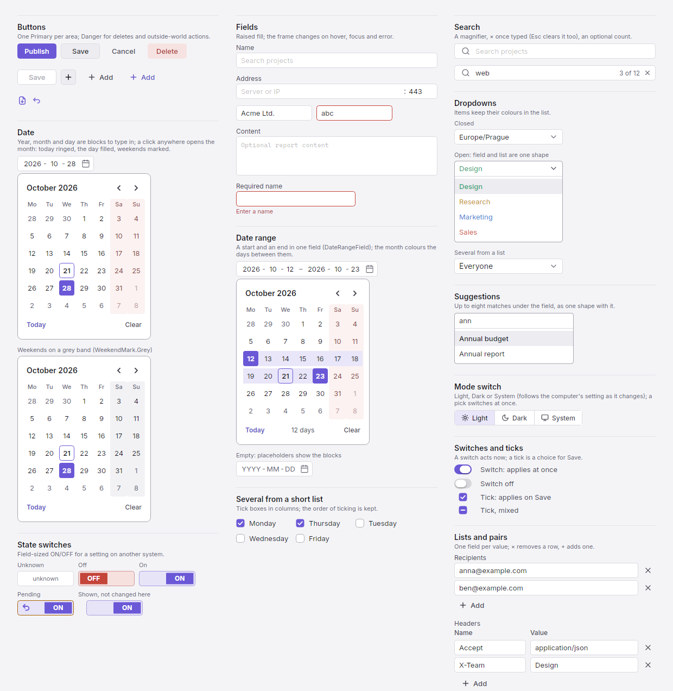
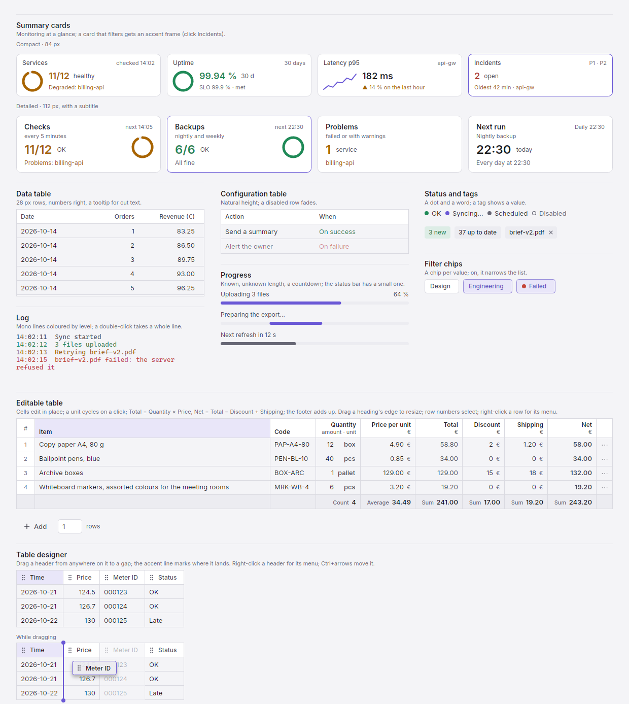
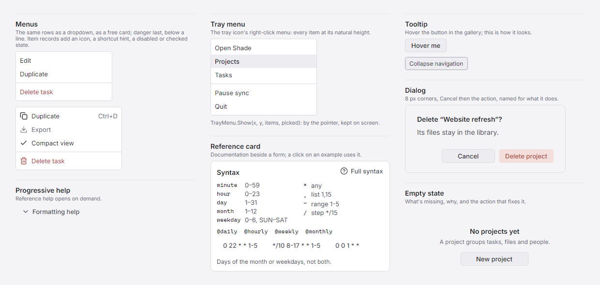
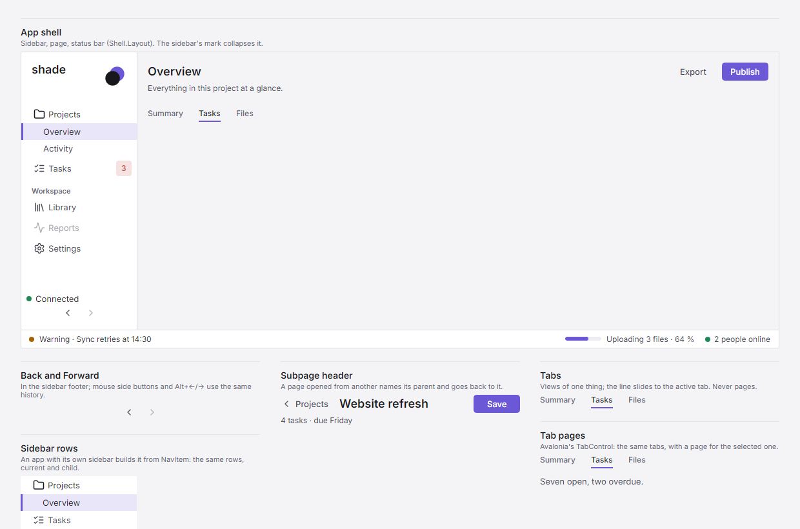
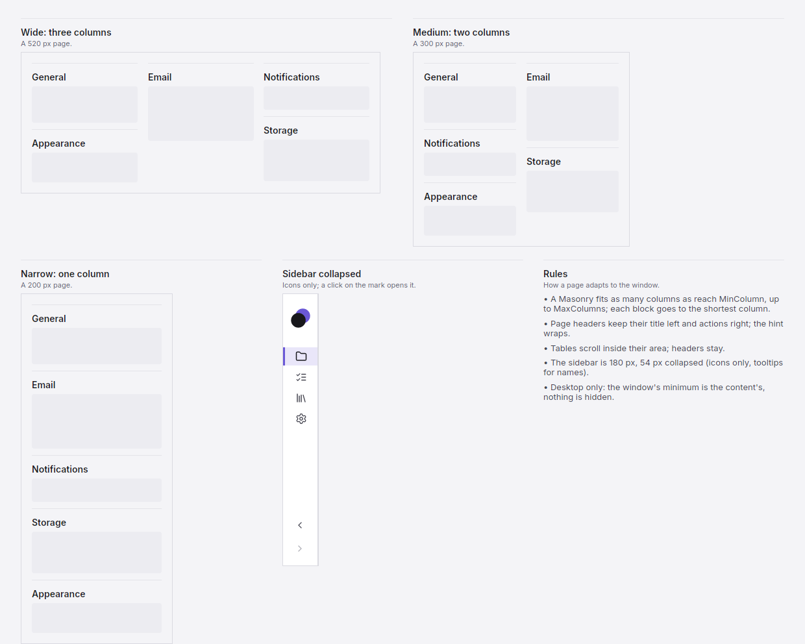

# Shade

A dark-first design system for Avalonia 12 desktop apps (.NET 10), with a matching light mode that switches live: colour
roles, type, spacing and every shared control, so each app stops rebuilding buttons, fields and menus.

**[Open the live page](https://jurasekdominik.github.io/shade/)** (Light / Dark switch at the top right; every component works there, in HTML and CSS) ·
**[DESIGN.md](DESIGN.md)** (the tokens and rules) · **[DESIGN_SYSTEM.md](docs/DESIGN_SYSTEM.md)** (the full rules)

The images below follow your GitHub theme.

## Foundations

### 01 / Colors

Thirteen roles named by their job. Tints, hovers and text on colour follow rules, in both modes.

<picture>
  <source media="(prefers-color-scheme: dark)" srcset="docs/preview/dark/01-colors.png">
  
</picture>

### 02 / Typography

Inter for the interface, Cascadia Code for values. Five sizes, nothing in between.

<picture>
  <source media="(prefers-color-scheme: dark)" srcset="docs/preview/dark/02-typography.png">
  
</picture>

### 03 / Spacing · Radii

A 4 px grid, two corner sizes, two heights.

<picture>
  <source media="(prefers-color-scheme: dark)" srcset="docs/preview/dark/03-spacing-radii.png">
  
</picture>

## Components

### 04 / Actions & inputs

What people click and type into.

<picture>
  <source media="(prefers-color-scheme: dark)" srcset="docs/preview/dark/04-actions-inputs.png">
  
</picture>

### 05 / Data & status

What the app shows back: figures, rows, states and work under way.

<picture>
  <source media="(prefers-color-scheme: dark)" srcset="docs/preview/dark/05-data-status.png">
  
</picture>

### 06 / Overlays & help

What opens over a page, and the help beside a form.

<picture>
  <source media="(prefers-color-scheme: dark)" srcset="docs/preview/dark/06-overlays-help.png">
  
</picture>

## Patterns

### 07 / Navigation

The sidebar says where you are; tabs switch views of one thing; Back returns.

<picture>
  <source media="(prefers-color-scheme: dark)" srcset="docs/preview/dark/07-navigation.png">
  
</picture>

### 08 / Responsive

Blocks reflow into as many columns as fit; the sidebar collapses to its icons.

<picture>
  <source media="(prefers-color-scheme: dark)" srcset="docs/preview/dark/08-responsive.png">
  
</picture>

## What's in it

| Area | Code |
| --- | --- |
| Tokens and theme: two modes, colour roles, accent rules, spacing, corners, fonts (Inter, Cascadia Code), scroll bars, tooltips, text boxes | `Look` (`Look.SetMode`, `Look.SetAccent`, `Look.Apply`), `Tone` (a role and its live brush) |
| Buttons | `ActionButton` (Primary, Normal, Ghost, Danger), `IconButton`, `Capsule`, `NavigationButtons` |
| Fields and pickers | `Field`, `HostPortField`, `SuggestionField`, `ListField`, `ChoiceButton` (dropdown), `MultiChoice`, `Menu`, `ColorGrid` (colour helper), `AccentPicker` (the accent as a settings row; `AccentPicker.Apply` restores a saved one), `DateField` (a day as YYYY-MM-DD blocks, or picked in a month), `DateRangeField` (a start and an end), `TableDesigner` (a table's columns, reordered by dragging into the gap between two), `ModeSwitch` (Light, Dark or System) |
| Toggles and tabs | `Switch`, `Tick`, `TickGrid`, `StateToggle`, `StateLook`, `FilterChip`, `TextTabs` |
| Status and tags | `StatusBadge`, `Tag` |
| Monitoring and work | `SummaryCards`, `SearchField`, `Progress`, `StatusBar.Busy`, `ReferenceCard`, `TrayMenu` |
| Data | `Workbench.Table` (with `Workbench.Mark` for a search), `EditableTable` (rows edited in place; its design mode arranges the columns), `CompactTable`, `PairTable`, `LogText`, `InlineCode` |
| Layout | `FormLayout` (page header, subpage header, numbered chapter, blocks, `Masonry`, disclosure, sizes), `Build` (text, cards, icons, motion, empty state) |
| Dialogs | `Dialog` (base window), `Ask.Confirm`, `Ask.ConfirmDelete`, `Ask.Info` |
| App shell | `Sidebar` + `NavEntry` (brand, collapsing rail, Back/Forward), `NavItem` (its rows, for an app's own sidebar), `StatusBar`, `Shell.Layout` |
| Icons | `Icons` (Lucide, drawn with `Build.Icon24`) |

The rules behind them: [docs/DESIGN_SYSTEM.md](docs/DESIGN_SYSTEM.md).

## Use it in an app

From nuget.org:

```xml
<PackageReference Include="Shade" Version="0.4.4" />
```

Working on Shade and an app together: reference the project instead (`<ProjectReference Include="..\shade\src\Shade\Shade.csproj" />`),
so a change shows at once.

## Rules for an app's agents

Paste this into the app's `AGENTS.md` (or `CLAUDE.md`):

> **UI uses only Shade.** Read Shade's `DESIGN.md` first (in the package, or the repository) and find the control in
> *Choosing a component*. No raw Avalonia input controls (`Button`, `TextBox`, `ComboBox`, `CheckBox`, `ToggleSwitch`,
> `DatePicker`, `ProgressBar`), no `Color.Parse`, `Colors.*` or hex in views, no font sizes, corners or heights as numbers,
> no component hand-built from a `Border`; paint with roles (`B(Raised)`, `Build.Text(text, Text2)`). **If nothing fits,
> stop and propose a Shade component; never build or copy one in the app.** A real exception is one line marked
> `// shade-exception: <why>`.

And this check in the app's CI, so a slip fails the build (adjust the folder; the app's own look file is allowed):

```bash
! grep -rnE 'Color\.Parse\("#|\bColors\.[A-Z]|CornerRadius\([0-9]|FontSize *= *[0-9]|new (Button|TextBox|ComboBox|CheckBox|ToggleSwitch|DatePicker|ProgressBar)\b' App/ --include=*.cs | grep -v 'shade-exception'
```

What each release changed:

| Version | Changes |
| --- | --- |
| 0.4.4 | `EditableTable`: column widths `Sizing` Fit (content, never cut), Fill (the room left) or Fixed, with `MinWidth` and `MaxWidth`; a resize sets a Fill column's minimum. Cells are text with one moving editor (caret where clicked, Tab to the next cell); selection, sorting and new rows update in place, keeping focus and caret; the focus ring no longer stays behind. The heading and footer stay put while the rows scroll, the scroll bars outside the grid. The current column's heading has the accent tint instead of an underline. A right-click on a row number opens the row menu. The designer's grip shows on hover, so headings keep their width. Much faster with many rows. Fix: `DateField`'s calendar icon opened and closed the month in one click. |
| 0.4.3 | `EditableTable` counts in decimals: computed columns and footers add money up to the cent, as an export does (`Exact`, `FooterValue`; `Value` stays, as a double). `Calculate`: an app with its own money rules supplies a computed column's values, and `FromTerms` keeps the table's formula for the columns it leaves. |
| 0.4.2 | Fix: `EditableTable`'s footer shows its function and value on one baseline, right-aligned in number columns, as on the live page. |
| 0.4.1 | The controls the live page previewed in 0.4.0. `DateField`: year, month and day are blocks to type in (digits move on, Up/Down change, Ctrl+V reads a day); a click anywhere opens the month; Alt+Down or F4 for the keyboard. `DateRangeField`: a start and an end in one field, the days between coloured in the month. `EditableTable`: cells edited in place, values with units, computed columns of any number of columns, a footer (Sum, Average, Min, Max, Count), column resizing, three-state sorting, row selection and a row menu, several rows added at once, and a design mode that is the table designer. Search matches: `Build.Mark`, `Workbench.Mark` on a table, and the suggestion list marks the typed letters. |
| 0.4.0 | Breaking: `ButtonKind.Soft` removed (it painted as `Normal`), `GearButton` removed (unused). `DESIGN.md` follows the design.md format, ships in the package and has *Choosing a component*; apps get a rules block and a CI check (*Rules for an app's agents*). Contrast: small accent text reads at 4.5:1 on its tint too; the Danger button uses the Danger tint and Danger text roles. One keyboard focus rule for buttons, dropdowns, dates and the designer. Icon `Ellipsis`. The live page has subsections and previews the next controls: date blocks with a range, search highlights, the editable table with its designer. The public API is now listed as shipped. |
| 0.3.3 | `ModeSwitch`: Light, Dark or System (the computer's setting, followed live) as one segmented control; `ModeSwitch.Apply` restores a saved choice. Icons `Sun`, `Moon`. Fix: `TableDesigner`'s RowFill, Locked and EmptyText draw again when set after the rows. The live page's top-bar switch is the same component, with System. |
| 0.3.2 | `TableDesigner`: a table's columns over preview rows; a header is dragged from anywhere on it to the gap between two columns (an accent line marks it), fields drop in from other controls (`DragSource`); right-click menu (insert before/after, remove), Ctrl+Left/Right moves. |
| 0.3.1 | `DateField`: a day, typed (2026-10-24 or 24.10.2026) or picked in the month its calendar icon opens; keyboard; Min/Max; weekends marked red (default), grey or not at all (`WeekendMark`). Icons `Calendar`, `ChevronRight`. |
| 0.3.0 | `AccentPicker`: the accent as a settings row (dot and name, Custom hex field, curated swatches; the field opens the colour helper), with `AccentPicker.Apply(value)` to restore a saved accent at start-up. |
| 0.2.2 | Fix: a dropdown (and a multi-choice) closed by a click on it keeps its hover border at once, instead of its resting border until the pointer moves. |
| 0.2.1 | Fixes: a dropdown's text no longer moves when its list opens, and its focus ring shows only for keyboard focus (not after a pick by the pointer); a click on the background takes the focus out of a field (`Look.Apply`). |
| 0.2.0 | An app's own mark: `Look.Apply(..., mark: (g, box, colour, phase, icon) => ...)` draws it wherever Shade draws the mark (window icons, `Look.Mark`, the sidebar, dialogs); `Look.PaintMark`. `StateToggle.UnknownText`: the words while the state is unknown. |
| 0.1.0 | The first package. |

Releasing: push a tag (`git tag v0.2.0 && git push origin v0.2.0`), or run the Publish workflow with a version (it tags the commit); `publish.yml` tests, packs and publishes that version
(nuget.org Trusted Publishing, no stored key). While the version is 0.x: a new component or a fix is the next patch
(0.3.1, 0.3.2…), the minor number moves only when a release breaks the API, and the notes say so.

Then:

```csharp
using Shade;
using static Shade.Look;

sealed class App : Application
{
    public override void Initialize()
    {
        Look.Apply(this, "MyApp");                                      // Fluent + the Shade styles (dark by default); the name titles dialogs
    }
    public override void OnFrameworkInitializationCompleted()
    {
        Look.SetAccent(Color.Parse("#8C7AE6"));                       // optional: the app's accent
        // Look.SetMode(Look.Mode.Light) switches every open window live, at any time
        var nav = new[] { new NavEntry("Home", "home", Icons.Monitor), new NavEntry("Settings", "settings", Icons.Settings) };
        var sidebar = new Sidebar("myapp", "Tagline.", nav); sidebar.Select("home");
        var page = new StackPanel { Margin = new Thickness(16), Children = { FormLayout.Header("Home", "What this page is for.", new ActionButton("Save", ButtonKind.Primary)) } };
        ((IClassicDesktopStyleApplicationLifetime)ApplicationLifetime).MainWindow =
            new Window { Background = B(Background), Icon = Look.Icon(Accent), Content = Shell.Layout(sidebar, page, new StatusBar()) };
        base.OnFrameworkInitializationCompleted();
    }
}
```

Or in XAML, bound to a view model (`xmlns:shade="using:Shade"`):

```xml
<shade:Switch On="{Binding Enabled}" />
<shade:Field Text="{Binding Name}" />
<shade:Progress Value="{Binding Share}" Label="Uploading" />
<shade:SummaryCards Items="{Binding Cards}" Detailed="True" />
<shade:ActionButton Text="Save" Kind="Primary" Command="{Binding Save}" />
```

The values people change (Switch.On, Tick.State, StateToggle.On, Field.Text, TextTabs.Active, ChoiceButton.Current)
bind both ways; Progress, SummaryCards and Masonry take their settings as Avalonia properties. The builders that take
their content in code (Sidebar, tables, ReferenceCard, TickGrid, MultiChoice) are made in code.

Paint with roles, so a new mode or accent repaints everything: `B(Raised)`, `Build.Text("Name", Text2)`. Work a computed
colour (a blend, a state) out in the control's `Restyle()` (implement `IRestyle`), which `Look` calls on every switch. `Look.Apply(this, name, markIcon: true)` also gives every window the mark as its icon, in the accent; `mark: (g, box, colour, phase, icon) => ...` draws the app's own mark instead of Shade's two discs, wherever Shade draws one (icons, `Look.Mark`, the sidebar's default, dialogs). Set the app's default font to `avares://Shade/Assets/Inter#Inter` (`.With(new FontManagerOptions { DefaultFamilyName = ... })`).

## Gallery and docs

```bash
dotnet run --project gallery -c Release                  # the showcase window: hover, click, pick an accent, switch the mode live
dotnet run --project gallery -c Release -- --docs .      # checks, then the previews, DESIGN.md and the live page (docs/index.html)
dotnet run --project tests/Shade.Tests -c Release        # the colour rules, the parsers, and the controls in XAML with bindings
```

The checks: text contrast in both modes, the suggestion field's open shape, and a live switch painting exactly what a
fresh build paints, pixel for pixel, for every chapter in both directions. CI runs them on every push.

## Limits

- A fixed colour (`new Tone(color)`, or a blend set outside `IRestyle.Restyle`) does not follow a switch; roles and `Restyle` do.
- An open popup (a menu, a tooltip) follows a switch in its role colours; its computed ones (a row's highlight) on its next open.
- Checked through the headless render on Linux; run the gallery on Windows to check it for real.
