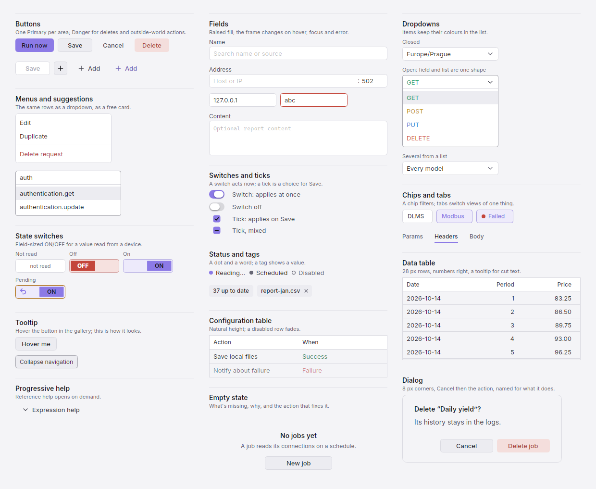
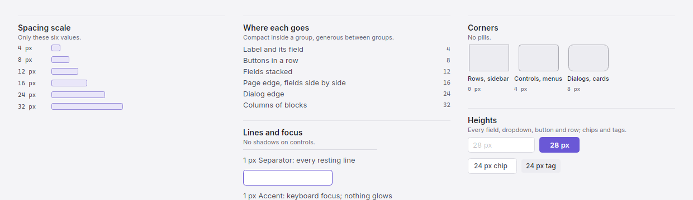
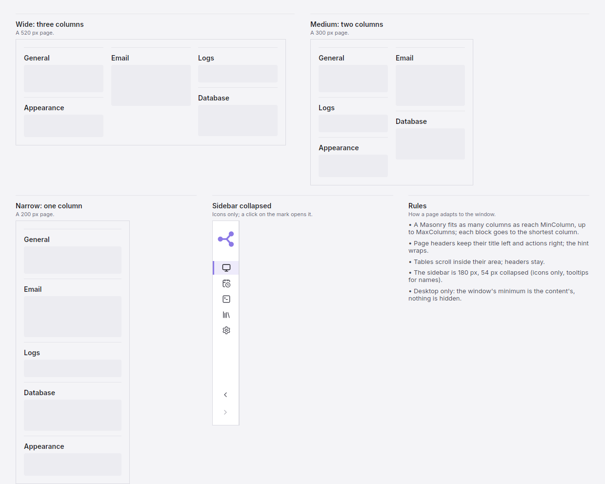
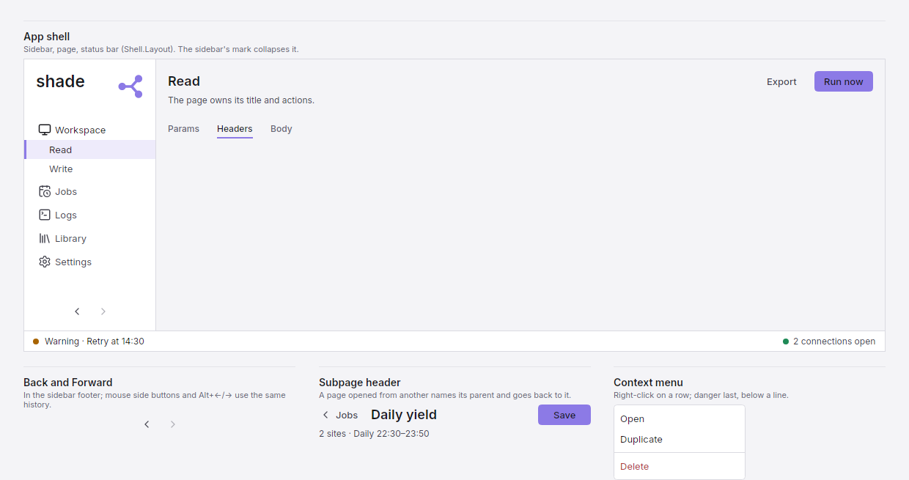

# Shade

A dark-first design system for Avalonia 12 desktop apps (.NET 10), with a matching light mode that switches live: colour
roles, type, spacing and every shared control, so each app stops rebuilding buttons, fields and menus.

**[Open the live page](https://jurasekdominik.github.io/shade/)** (Light / Dark switch at the top right; every component works there, in HTML and CSS) ·
**[DESIGN.md](DESIGN.md)** (the tokens and rules) · **[DESIGN_SYSTEM.md](docs/DESIGN_SYSTEM.md)** (the full rules)

The images below follow your GitHub theme.

## 01 / Colors

Thirteen roles named by their job. Tints, hovers and text on colour follow rules, in both modes.

<picture>
  <source media="(prefers-color-scheme: dark)" srcset="docs/preview/dark/01-colors.png">
  
</picture>

## 02 / Typography

Inter for the interface, Cascadia Code for values. Five sizes, nothing in between.

<picture>
  <source media="(prefers-color-scheme: dark)" srcset="docs/preview/dark/02-typography.png">
  
</picture>

## 03 / Components

One implementation each, every state shown.

<picture>
  <source media="(prefers-color-scheme: dark)" srcset="docs/preview/dark/03-components.png">
  
</picture>

## 04 / Spacing · Radii

A 4 px grid, two corner sizes, two heights.

<picture>
  <source media="(prefers-color-scheme: dark)" srcset="docs/preview/dark/04-spacing-radii.png">
  
</picture>

## 05 / Responsive

Blocks reflow into as many columns as fit; the sidebar collapses to its icons.

<picture>
  <source media="(prefers-color-scheme: dark)" srcset="docs/preview/dark/05-responsive.png">
  
</picture>

## 06 / Navigation

The sidebar says where you are; tabs switch views of one thing; Back returns.

<picture>
  <source media="(prefers-color-scheme: dark)" srcset="docs/preview/dark/06-navigation.png">
  
</picture>

## What's in it

| Area | Code |
| --- | --- |
| Tokens and theme: two modes, colour roles, accent rules, spacing, corners, fonts (Inter, Cascadia Code), scroll bars, tooltips, text boxes | `Look` (`Look.SetMode`, `Look.SetAccent`, `Look.Apply`), `Tone` (a role and its live brush) |
| Buttons | `Btn` (Primary, Normal, Ghost, Del), `IconButton`, `GearButton`, `Capsule`, `NavigationButtons` |
| Fields and pickers | `Field`, `HostPortField`, `SuggestionField`, `ListField`, `ChoiceButton` (dropdown), `MultiChoice`, `Menu`, `ColorGrid` (colour picker) |
| Toggles and tabs | `Switch`, `Tick`, `TickGrid`, `StateToggle`, `StateLook`, `FilterChip`, `TextTabs` |
| Status and tags | `StatusBadge`, `Tag` |
| Data | `Workbench.Table`, `CompactTable`, `PairTable`, `LogText`, `InlineCode` |
| Layout | `FormLayout` (page header, subpage header, numbered chapter, blocks, `Masonry`, disclosure, sizes), `Kit` (text, cards, icons, motion, empty state) |
| Dialogs | `Dialog` (base window), `Ask.Confirm`, `Ask.ConfirmDelete`, `Ask.Info` |
| App shell | `Sidebar` + `NavEntry` (brand, collapsing rail, Back/Forward), `StatusBar`, `Shell.Layout` |
| Icons | `Icons` (Lucide, drawn with `Kit.Icon24`) |

The rules behind them: [docs/DESIGN_SYSTEM.md](docs/DESIGN_SYSTEM.md).

## Use it in an app

Reference the project (a sibling clone or a git submodule):

```xml
<ProjectReference Include="..\shade\src\Shade\Shade.csproj" />
```

or pack it once (`dotnet pack src/Shade -c Release -o ~/nuget-local`) and add `<PackageReference Include="Shade" Version="1.0.0" />`
with `~/nuget-local` as a package source.

Then:

```csharp
using Shade;
using static Shade.Look;

sealed class App : Application
{
    public override void Initialize()
    {
        Look.Apply(this);                                               // Fluent + the Shade styles (dark by default)
    }
    public override void OnFrameworkInitializationCompleted()
    {
        Look.AppName = "MyApp";                                       // dialog titles
        Look.SetAccent(Color.Parse("#8C7AE6"));                       // optional: the app's accent
        // Look.SetMode(Look.Mode.Light) switches every open window live, at any time
        var nav = new[] { new NavEntry("Home", "home", Icons.Monitor), new NavEntry("Settings", "settings", Icons.Settings) };
        var sidebar = new Sidebar("myapp", "Tagline.", nav); sidebar.Select("home");
        var page = new StackPanel { Margin = new Thickness(16), Children = { FormLayout.Header("Home", "What this page is for.", new Btn("Save", BtnKind.Primary)) } };
        ((IClassicDesktopStyleApplicationLifetime)ApplicationLifetime).MainWindow =
            new Window { Background = B(Bg), Icon = Look.Icon(Accent), Content = Shell.Layout(sidebar, page, new StatusBar()) };
        base.OnFrameworkInitializationCompleted();
    }
}
```

Paint with roles, so a new mode or accent repaints everything: `B(Surface)`, `Kit.Text("Name", Second)`. Work a computed
colour (a blend, a state) out in the control's `Restyle()`, which `Look` calls on every switch. Set the app's default font to `avares://Shade/Assets/Inter#Inter` (`.With(new FontManagerOptions { DefaultFamilyName = ... })`).

## Gallery and docs

```bash
dotnet run --project gallery -c Release                  # the showcase window: hover, click, pick an accent, switch the mode live
dotnet run --project gallery -c Release -- --docs .      # checks, then the previews, DESIGN.md and the live page (docs/index.html)
```

The checks: text contrast in both modes, the suggestion field's open shape, and a live switch painting exactly what a
fresh build paints, pixel for pixel, for every chapter in both directions. CI runs them on every push.

## Limits

- A fixed colour (`new Tone(color)`, or a blend set outside `Restyle`) does not follow a switch; roles and `Restyle` do.
- An open popup (a menu, a tooltip) follows a switch in its role colours; its computed ones (a row's highlight) on its next open.
- Checked through the headless render on Linux; run the gallery on Windows to check it for real.
