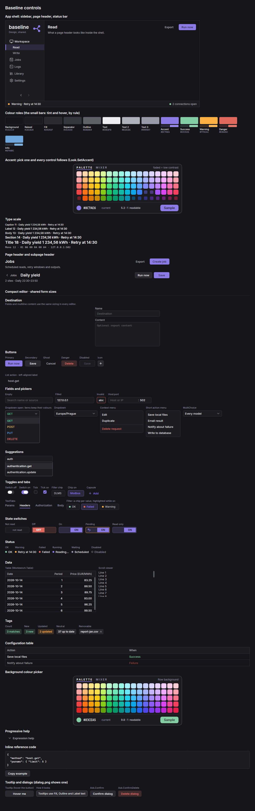

# Baseline

A dark, dense design system for Avalonia 12 desktop apps (.NET 10): colour roles, type scale, the theme on top of Fluent,
and the shared controls, so each app stops rebuilding buttons, fields and menus. Taken from Harvest.



## What's in it

| Area | Code |
| --- | --- |
| Tokens and theme: colours, accent rules, fonts (Inter, Cascadia Code), scroll bars, tooltips, text boxes | `Look` (`Look.Apply`, `Look.SetAccent`, `Look.Recolor`) |
| Buttons | `Btn` (Primary, Normal, Ghost, Del), `IconButton`, `GearButton`, `Capsule`, `NavigationButtons` |
| Fields and pickers | `Field`, `HostPortField`, `SuggestionField`, `ListField`, `ChoiceButton` (dropdown), `MultiChoice`, `Menu`, `ColorGrid` (colour picker) |
| Toggles and tabs | `Switch`, `Tick`, `TickGrid`, `StateToggle`, `StateLook`, `FilterChip`, `TextTabs` |
| Status and tags | `StatusBadge`, `Tag` |
| Data | `Workbench.Table`, `CompactTable`, `PairTable`, `LogText`, `InlineCode` |
| Layout | `FormLayout` (page header, subpage header, blocks, disclosure, sizes), `Kit` (text, cards, icons, motion) |
| Dialogs | `Dialog` (base window), `Ask.Confirm`, `Ask.ConfirmDelete`, `Ask.Info` |
| App shell | `Sidebar` + `NavEntry` (brand, collapsing rail, Back/Forward), `StatusBar`, `Shell.Layout` |
| Icons | `Icons` (Lucide, drawn with `Kit.Icon24`) |

The rules behind them: [docs/DESIGN_SYSTEM.md](docs/DESIGN_SYSTEM.md).

## Use it in an app

Reference the project (a sibling clone or a git submodule):

```xml
<ProjectReference Include="..\baseline\src\Baseline\Baseline.csproj" />
```

or pack it once (`dotnet pack src/Baseline -c Release -o ~/nuget-local`) and add `<PackageReference Include="Baseline" Version="1.0.0" />`
with `~/nuget-local` as a package source.

Then:

```csharp
using Baseline;
using static Baseline.Look;

sealed class App : Application
{
    public override void Initialize() => Look.Apply(this);           // Fluent dark + the Baseline styles
    public override void OnFrameworkInitializationCompleted()
    {
        Look.AppName = "MyApp";                                       // dialog titles
        Look.SetAccent(Color.Parse("#8C7AE6"));                       // optional: the app's accent
        var nav = new[] { new NavEntry("Home", "home", Icons.Monitor), new NavEntry("Settings", "settings", Icons.Settings) };
        var sidebar = new Sidebar("myapp", "Tagline.", nav); sidebar.Select("home");
        var page = new StackPanel { Margin = new Thickness(16), Children = { FormLayout.Header("Home", "What this page is for.", new Btn("Save", BtnKind.Primary)) } };
        ((IClassicDesktopStyleApplicationLifetime)ApplicationLifetime).MainWindow =
            new Window { Background = B(Bg), Icon = Look.Icon(Accent), Content = Shell.Layout(sidebar, page, new StatusBar()) };
        base.OnFrameworkInitializationCompleted();
    }
}
```

Set the app's default font to `avares://Baseline/Assets/Inter#Inter` (`.With(new FontManagerOptions { DefaultFamilyName = ... })`).

## Gallery

```bash
dotnet run --project gallery -c Release                     # the gallery window: hover, click, pick an accent
dotnet run --project gallery -c Release -- --png <folder>   # gallery.png and dialog.png, headless
```

## Limits

- Dark theme only; no light variant.
- Controls are built in C#, not XAML; there are no XAML styles or resource keys to override, only the `Look` tokens.
- Tested only through the headless gallery render on Linux; run the gallery on Windows to check it for real.
