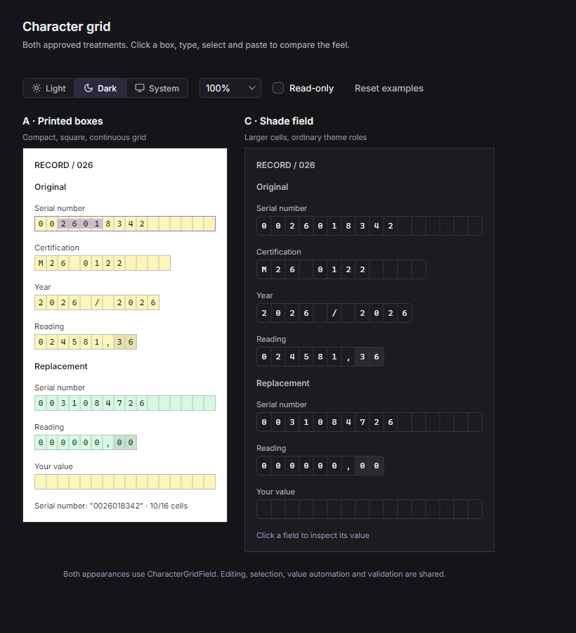
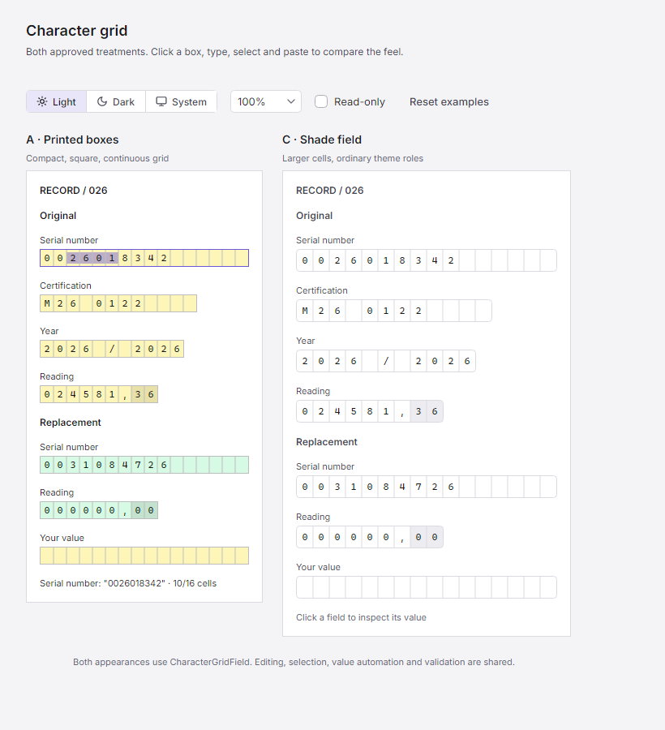

# Character grid prototypes

The two approved native Avalonia treatments for [issue #105](https://github.com/jurasekdominik/shade/issues/105) now use
the shared library's `CharacterGridField`. The corrected selection is A and C from the original comparison; both are
publicly selectable through `Appearance = Paper` or `Field`.
The supported API and remaining issue work are in [ADOPTION.md](../ADOPTION.md#character-grids).

To test the feedback branch, install the .NET 10 SDK, then clone and run:

```powershell
git clone --branch feat/105-character-grid-field --single-branch https://github.com/jurasekdominik/shade.git
cd shade
dotnet run --project gallery -c Release -- --character-grid
```

For an existing checkout, fetch and switch to `feat/105-character-grid-field`, then run the same `dotnet run` command
from the repository root:

```powershell
dotnet run --project gallery -c Release -- --character-grid
```

| Treatment | What to judge |
| --- | --- |
| A · Printed boxes | Compact 16 × 20 DIP cells, square corners and a continuous grid over yellow/green document fills. |
| C · Shade field | Roomier 20-DIP cells, a 28-DIP field height, rounded outer corners and ordinary Shade roles. |

Click any box and type. Try arrows, drag selection, Shift+arrows, replacing a selection, paste and undo/redo. The toolbar
switches the shell mode, document zoom and read-only state. Reset examples restores the synthetic sample values.
Different field lengths retain the same pitch; the reading's last two cells have a separate fill. The paper surfaces
keep their fill/ink contrast inside either shell mode. No domain parsing or persistence is involved.

Leave feedback in [issue #105](https://github.com/jurasekdominik/shade/issues/105). Include the tested commit
(`git rev-parse --short HEAD`), A or C, OS/display scale, light or dark mode, steps and expected versus actual behavior.
Screenshots help assess appearance; please call out typing, selection, paste, IME or accessibility problems separately.
This branch is a preview for feedback, not a published NuGet release. Apps testing the component can temporarily replace
their Shade package reference with a project reference to this checkout's `src/Shade/Shade.csproj`.





The [comparison window](../../gallery/CharacterGridPrototypes.cs) consumes the shared component. Native Avalonia owns
editing, hit testing, selection, clipboard, undo, focus and IME over fixed-advance shaped graphemes. The main gallery
also shows both appearances, empty/read-only/disabled/pending/invalid states and a decorated decimal tail.

## Status

The original letter-spacing prototype has been removed. The shared presenter now covers fixed pitch with proportional
fonts, composed graphemes and fallback, and fixes full-capacity caret placement. Range styling and binding/validation
are public. Both variants expose named value automation and reject read-only/disabled automation writes. Remaining
limitations and unverified platform checks live in [the component's adoption contract](../ADOPTION.md#character-grids).
Issue #105 stays open; this has not been packaged or released, and the web port follows the release workflow.

Regenerate the two previews and run the focused prototype checks with:

```powershell
dotnet run --project gallery -c Release -- --character-grid-previews docs/proposals/character-grid-previews
```

Those checks exercise native pitch, pointer placement at 75/100/150% document zoom, two-way binding after edits, insertion,
selection replacement, precomposed Czech characters, undo, read-only and overflow. They also compare live mode switches
with fresh construction pixel for pixel. They do not replace native Windows pointer, DPI, IME or screen-reader testing.
